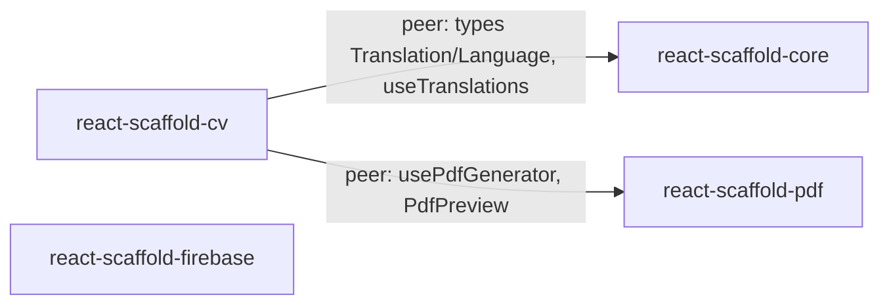

# React Scaffold — Project Context

> Main context file for the repository. Each package has its own `context.md` plus a `context/` folder with detailed documents.

## 1. Purpose

`react-scaffold` (by **eliseubatista99**) is a collection of independently published React libraries that provide reusable components, hooks, helpers and providers so that new React applications do not need to re-implement common code.

The repository root is **not** a library itself: it is a Vite + Storybook workspace used to develop, document and showcase the packages located in `src/packages/*`.

| Package  | npm name                                   | Version | Purpose                                                                                         | Context                                                              |
| -------- | ------------------------------------------ | ------- | ----------------------------------------------------------------------------------------------- | -------------------------------------------------------------------- |
| core     | `@eliseubatista99/react-scaffold-core`     | 2.0.1   | Base UI components, hooks, helpers, providers (navigation, feedback), i18n, forms               | [src/packages/core/context.md](src/packages/core/context.md)         |
| pdf      | `@eliseubatista99/react-scaffold-pdf`      | 1.0.1   | PDF generation (`@react-pdf/renderer`), PDF preview and rendering (`react-pdf`)                 | [src/packages/pdf/context.md](src/packages/pdf/context.md)           |
| cv       | `@eliseubatista99/react-scaffold-cv`       | 1.0.1   | CV/résumé PDF templates (Classic, Modern, Timeline), CV generator hooks, multi-language CV data | [src/packages/cv/context.md](src/packages/cv/context.md)             |
| firebase | `@eliseubatista99/react-scaffold-firebase` | 1.0.19  | Firebase app init, Auth provider, Firestore CRUD hook, Storage upload helper                    | [src/packages/firebase/context.md](src/packages/firebase/context.md) |

## 2. Package dependency graph



- `core`, `pdf` and `firebase` have **no** dependency on other scaffold packages.
- `cv` imports `@eliseubatista99/react-scaffold-core` and `@eliseubatista99/react-scaffold-pdf` **by package name** (not by relative path). Those imports resolve to the versions installed in `node_modules` (published npm builds), **not** to the local source in `src/packages/*`. Local changes in `core`/`pdf` are only visible to `cv` after publishing (or linking).

## 3. Repository layout

```
/                         Root workspace (Vite app + Storybook host)
├── .storybook/           Storybook config (main.ts, preview.ts)
├── .github/appmod/       (empty folder)
├── public/               Static assets served by Vite/Storybook (vite.svg)
├── src/
│   ├── main.tsx          Default Vite React entry (renders App in StrictMode)
│   ├── App.tsx           Default Vite "count" boilerplate — not used by packages
│   ├── App.css, index.css
│   ├── assets/           font/ (OpenSans), icon/ (percolate icon font), react.svg
│   └── packages/
│       ├── core/         Each package is a standalone Vite library project
│       ├── cv/
│       ├── firebase/
│       └── pdf/
├── storybook-static/     Built Storybook output (git-ignored, deployed to Netlify)
├── dist/                 Build output (git-ignored)
├── netlify.toml          Netlify deploy of Storybook
├── package.json          Root workspace manifest (Storybook + all peer deps as devDeps)
├── vite.config.ts        Minimal: `plugins: [react()]`
├── tsconfig*.json        Project references (app + node)
├── eslint.config.js      ESLint flat config (typescript-eslint, react-hooks, react-refresh)
├── yarn.lock / package-lock.json   Both lockfiles present
└── .yarnrc.yml           `nodeLinker: node-modules`
```

Each package folder has the same structure:

```
src/packages/<name>/
├── context.md            Package main context file
├── context/              Detailed package context documents
├── package.json          Publishable manifest (files: ["dist/"])
├── package-lock.json
├── vite.config.ts        Library-mode build (es + cjs) + vite-plugin-dts
├── tsconfig.json         Declaration-only emit (emitDeclarationOnly)
├── tsconfig.app.json / tsconfig.node.json
├── public/vite.svg
├── README.md
└── src/
    ├── index.ts          Barrel export of the public API
    └── components/ hooks/ helpers/ providers/ types/ ...
```

## 4. Tooling

### Root workspace

- **Package manager:** `yarn@4.10.3` (`packageManager` field) with `nodeLinker: node-modules`. A `package-lock.json` also exists.
- **Root `package.json`:** name `react-scaffold-eliseubatista99`, private, `type: module`; metadata points to this repository.
- **Root devDependencies** include every runtime peer of the packages (react 19, react-dom 19, react-router-dom 7, react-slick, slick-carousel, dayjs, @emotion/react, @emotion/styled, @react-pdf/renderer 4, react-pdf 10, react-to-pdf 2, msw 2, msw-storybook-addon) and the four scaffold packages with version `"*"` (installed from npm).
- `firebase` is **not** in the root devDependencies (no firebase stories exist).
- `resolutions`: `jackspeak@2.1.1`.

### Root scripts

| Script            | Command                        | Notes                                                         |
| ----------------- | ------------------------------ | ------------------------------------------------------------- |
| `start`           | `npm run typecheck && npm run typecheck:packages && storybook dev -p 6006` | Type-check root and package projects, then Storybook |
| `dev`             | `vite`                         | Runs the default boilerplate App                              |
| `build`           | `vite build && storybook build` | Builds the Vite app, then Storybook only if the first build succeeds |
| `preview`         | `vite preview`                 |                                                               |
| `storybook`       | `storybook dev -p 6006`        | Main development workflow                                     |
| `build-storybook` | `storybook build`              | Outputs `storybook-static/`                                   |
| `typecheck`       | `tsc -p tsconfig.app.json && tsc -p tsconfig.node.json` | Type-check the root app and Vite config |
| `typecheck:packages` | Explicit app/node typechecks for all four packages | Keeps each library's TypeScript settings isolated |
| `init-msw`        | `msw init public/`             | MSW worker (not currently used by stories)                    |
| `clean-vite`      | `vite --force`                 | Forces dependency re-optimization                             |

### Package scripts (identical in all packages)

`dev`/`start`: `vite` (firebase `dev` = `tsc && vite`), `build`: `rimraf dist && vite build`, `clean`: `rimraf dist`, `lint`: `eslint .`, `preview`: `vite preview`.

### Storybook (v9, `@storybook/react-vite`)

- `stories`: `../src/**/*.mdx`, `../src/**/*.stories.@(js|jsx|ts|tsx)` — picks up stories from **all packages**.
- `staticDirs`: `../public`. Addons: `@storybook/addon-links`, `@storybook/addon-docs`.
- `preview.ts`: only control matchers (`/(background|color)$/i` → color, `/Date$/` → date). No global decorators/providers.
- Story title hierarchy: `Core/Components/*`, `Core/Hooks/*`, `Core/Helpers/*`, `Core/Providers/*`, `CV/Components/*`, `CV/Hooks/*`, `Pdf/Components/*`, `Pdf/Hooks/*`.
- Stories use `tags: ["autodocs"]`, usually `parameters: { layout: "fullscreen" }`.
- When a hook/provider needs a wrapper, a co-located `stories/setup.tsx` exports a `*StoriesSetup` component used as the story `component`.

### Deployment

- `netlify.toml`: build `npm run build`, publish `storybook-static/`, SPA redirect `/* → /index.html (200)`.

### TypeScript

- Root: `tsconfig.json` references `tsconfig.app.json` (ES2020, bundler resolution, `noEmit`, strict, `noUnusedLocals`, `noUnusedParameters`, `noFallthroughCasesInSwitch`, `noUncheckedSideEffectImports`, `jsx: react-jsx`, includes only the root Vite app files) and `tsconfig.node.json`. Package sources are checked with their own `tsconfig.app.json` and `tsconfig.node.json` files.
- Packages: `tsconfig.json` with `target/module: ESNext`, `jsx: react-jsx`, `declaration`, `declarationDir: dist`, `emitDeclarationOnly`, `strict`, `moduleResolution: Node`, `skipLibCheck`.

### Package build (Vite library mode — same pattern in every package)

- Entry `src/index.ts`, formats `["es", "cjs"]`, files `dist/index.es.js` / `dist/index.cjs.js`; `pdf` and `cv` use the placeholder library name, while Firebase uses `ReactScaffoldFirebase`.
- `vite-plugin-dts({ insertTypesEntry: true })` generates `dist/index.d.ts`.
- `rollupOptions.external`: core externalizes `react`, `react-dom`, and `react-router-dom`; Firebase externalizes React and its JSX runtimes plus the modular Firebase modules it imports. Core keeps React Router external so its exported navigation APIs share the consuming application's router context.
- `pdf` uses `vite-plugin-static-copy` to copy `pdfjs-dist/cmaps` and `pdfjs-dist/standard_fonts` into `dist/`, and `assetsInclude: ["**/*.pdf"]` for its PDF story asset. CV does not use pdf.js directly.
- `package.json`: `main: dist/index.cjs.js`, `module: dist/index.es.js`, `types: dist/index.d.ts`, `files: ["dist/"]`, `publishConfig.access: public`, MIT license.

## 5. Cross-package conventions

- **Language:** TypeScript + React 19 function components; no class components (static helper classes are used for utilities).
- **Folder per unit:** `<unit>/<unit>.tsx`, optional `<unit>.hook.ts(x)` holding the logic (`use<Unit>Helper`), `index.ts` barrel, optional `stories/` (`<unit>.stories.tsx`, `setup.tsx`, example content).
- **Barrels everywhere:** every folder has an `index.ts` with `export * from "./..."`; the package `src/index.ts` re-exports the top-level folders.
- **Naming:** components PascalCase; props `<Component>Props`; hooks `use<Name>`; helper classes `<Name>Helper` with `static` arrow-function methods; providers `<Name>Provider` + `<name>Context.ts` + `use<Name>` hook.
- **Styling:** inline `CSSProperties` with sensible defaults, overridable through `styles`, `containerStyles`, `*Styles` props (spread last). `@emotion/styled` is used only where pseudo-selectors are needed (core). PDF templates use `@react-pdf/renderer` `StyleSheet.create`.
- **Visibility pattern (core):** overlays (`Modal`, `Drawer`, `Toast`, `Loader`) are driven by string ids through `FeedbackProvider` (`showItem(id)` / `hideItem(id)`).
- **i18n pattern:** `Translation = Record<string, string>` (e.g. `{ en: "...", pt: "..." }`) resolved by `useTranslations` from core.
- **Comments:** some source comments are in Portuguese (e.g. in `vite.config.ts`). Some UI strings in stories/cv component are in Portuguese.
- Automated tests currently exist for the core navigation provider (`src/packages/core/tests/navigation.test.tsx`, Vitest + Testing Library); the other packages do not yet have test suites. Storybook remains the primary visual validation workflow.

## 6. Development workflow

1. Install: `yarn install` (or `npm install`) at the root; for building a package, also install inside `src/packages/<name>`.
2. Develop/preview: `yarn storybook` at the root (port 6006).
3. Build a package: `cd src/packages/<name>` → `npm run build` → outputs `dist/`.
4. Run core navigation tests: `cd src/packages/core` → `npm test`.
5. Publish: bump `version` in the package `package.json` and publish to npm (manual; no CI workflow present).
6. Changelog: documented on GitHub Releases (per README).

## 7. Known repository-level issues

- `src/App.tsx` / `src/main.tsx` are untouched Vite boilerplate.
- `msw` / `msw-storybook-addon` are installed but not wired into Storybook.
- Both `yarn.lock` and `package-lock.json` exist at the root.
- Cross-package imports resolve to published npm versions, so local edits to `core`/`pdf` are not reflected in `cv` stories until republished.
- Package-specific issues are listed in each package's `context/known-issues.md`.

## 8. Context file index

Personal AI preferences are maintained by category in [ai-preferences/preferences.md](ai-preferences/preferences.md), with focused guidance files in [ai-preferences/](ai-preferences/). Workspace instructions in [.github/copilot-instructions.md](.github/copilot-instructions.md) point agents to these preferences.

| File                                                                 | Content                                                                                                              |
| -------------------------------------------------------------------- | -------------------------------------------------------------------------------------------------------------------- |
| [src/packages/core/context.md](src/packages/core/context.md)         | Core overview and API index                                                                                          |
| [src/packages/core/context/](src/packages/core/context/)             | `build-and-conventions.md`, `components.md`, `hooks.md`, `helpers.md`, `providers.md`, `types.md`, `known-issues.md` |
| [src/packages/pdf/context.md](src/packages/pdf/context.md)           | Pdf overview and API index                                                                                           |
| [src/packages/pdf/context/](src/packages/pdf/context/)               | `build-and-conventions.md`, `components.md`, `hooks.md`, `known-issues.md`                                           |
| [src/packages/cv/context.md](src/packages/cv/context.md)             | CV overview and API index                                                                                            |
| [src/packages/cv/context/](src/packages/cv/context/)                 | `build-and-conventions.md`, `types.md`, `templates.md`, `hooks-and-components.md`, `i18n.md`, `known-issues.md`      |
| [src/packages/firebase/context.md](src/packages/firebase/context.md) | Firebase overview and API index                                                                                      |
| [src/packages/firebase/context/](src/packages/firebase/context/)     | `build-and-conventions.md`, `providers.md`, `hooks.md`, `helpers.md`, `known-issues.md`                              |
