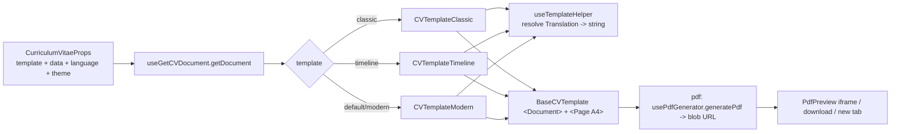

# @eliseubatista99/react-scaffold-cv — Package Context

> Main context file for the **cv** package. Detailed documents live in [context/](context/).

## Summary

| Field | Value |
|---|---|
| npm name | `@eliseubatista99/react-scaffold-cv` |
| Version | `1.0.1` |
| Location | `src/packages/cv` |
| Entry | `src/index.ts` → `dist/index.es.js`, `dist/index.cjs.js`, `dist/index.d.ts` |
| Peer deps | `@eliseubatista99/react-scaffold-core ^1.1.0`, `@eliseubatista99/react-scaffold-pdf ^1.0.1`, `@react-pdf/renderer ^4.3.0`, `react ^19.1.0`, `react-dom ^19.1.0`, `react-pdf ^10.0.1`, `react-router-dom ^7.6.3`, `react-to-pdf ^2.0.1` |
| Depends on | **core** (`Translation`, `TranslationList`, `Language`, `useTranslations`) and **pdf** (`usePdfGenerator`, `PdfPreview`) — imported by npm package name |

Generates CV / résumé PDFs with `@react-pdf/renderer` from a typed, multi-language data model (`CvData`). Ships three A4 templates (**Classic**, **Modern**, **Timeline**), a preview component and a generator hook (generate / download / open). UI labels are translated in English (`en`) and Portuguese (`pt`).

## Public API (exported from `src/index.ts`)

`src/index.ts` re-exports `./components`, `./hooks`, `./templates`, `./types`.

| Export | Kind | Details |
|---|---|---|
| `CurriculumVitae`, `CurriculumVitaeProps` | Component (in-browser PDF preview) | [context/hooks-and-components.md](context/hooks-and-components.md) |
| `useCVGenerator` (folder/file `useGenerateCV`) | Hook: `generateCV`, `downloadCV`, `previewCV` | [context/hooks-and-components.md](context/hooks-and-components.md) |
| `useGetCVDocument` | Hook: `getDocument(props)` → template JSX | [context/hooks-and-components.md](context/hooks-and-components.md) |
| `CvTemplates` | `{ Classic, Modern, Timeline }` template components | [context/templates.md](context/templates.md) |
| `CvData`, `PersonalInfo`, `Link`, `Experience`, `Education`, `Language`, `Certification`, `Project`, `Volunteer`, `CVTemplateType`, `LinkType`, `Month`, `EducationType`, `EducationStatus`, `LanguageLevel`, `BaseCVTemplateProps`, `CvTemplateProps`, `CvTheme` | Types | [context/types.md](context/types.md) |

**Not exported:** `BaseCVTemplate`, `useTemplateHelper`, individual `CVTemplateClassic/Modern/Timeline` (only via `CvTemplates`), `BaseTheme` (`src/theme`), `ExampleCvContent` and `CVTemplateBaseI18n` (`src/resources`).

## Folder structure

```
src/
├── index.ts
├── components/cv/          cv.tsx (CurriculumVitae), stories/cv.stories.tsx
├── hooks/
│   ├── useGenerateCV/      useGenerateCV.tsx (exports useCVGenerator), stories/ (setup.tsx, useGenerateCV.stories.tsx)
│   └── useGetCVDocument/   useGetCVDocument.tsx
├── templates/
│   ├── index.ts            CvTemplates map
│   ├── baseTemplate.tsx    <Document> wrapper
│   ├── templates.hook.ts   useTemplateHelper (i18n + data resolution + utils)
│   ├── classic/            classic.tsx, classic.styles.tsx, classic.i18n.ts
│   ├── modern/             modern.tsx, modern.styles.tsx, modern.i18n.ts
│   └── timeline/           timeline.tsx, timeline.styles.tsx, timeline.i18n.ts
├── types/                  cv.ts, template.ts
├── theme/                  theme.tsx (BaseTheme { color: "#2563eb" })
└── resources/              translations.ts (CVTemplateBaseI18n), exampleCV.ts (ExampleCvContent)
```

## Data flow



## Quick usage

```tsx
import { CurriculumVitae, useCVGenerator, CvData } from "@eliseubatista99/react-scaffold-cv";

const data: CvData = { personalInfo: { name: "Jane", city: "Lisbon", postalCode: "1000-001",
  email: "jane@x.com", countryCode: "+351", phone: "910000000",
  desiredRole: { en: "Developer", pt: "Programadora" } } };

<CurriculumVitae template="modern" language="pt" data={data} theme={{ color: "#0f766e" }} />

const { downloadCV } = useCVGenerator();
await downloadCV({ template: "classic", language: "en", data, title: "Jane-CV" }); // Jane-CV.pdf
```

## Detailed context files

| File | Content |
|---|---|
| [context/build-and-conventions.md](context/build-and-conventions.md) | package.json, Vite/TS config, conventions, stories, README |
| [context/types.md](context/types.md) | Full CV data model and template prop types |
| [context/templates.md](context/templates.md) | BaseCVTemplate, useTemplateHelper, Classic/Modern/Timeline layouts, styling and theme |
| [context/hooks-and-components.md](context/hooks-and-components.md) | `CurriculumVitae`, `useCVGenerator`, `useGetCVDocument` |
| [context/i18n.md](context/i18n.md) | Translation keys, per-template overrides, how data translation works, example CV |
| [context/known-issues.md](context/known-issues.md) | Bugs, quirks and inconsistencies |
